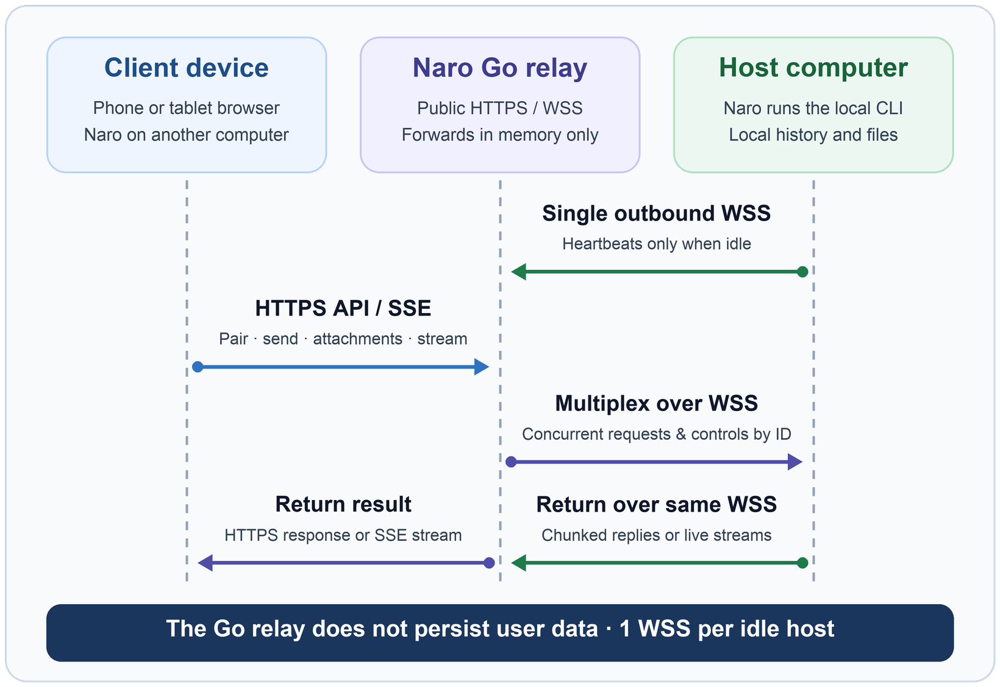

# Naro

[简体中文](README.md) · **English** · [日本語](README.ja.md)

Pick up your Codex, Claude Code, and Antigravity sessions from a computer, phone, or tablet. Naro runs the CLI on the host computer. Connect from the Naro desktop app on another computer or from the web on a phone or tablet.

[Source layout](#source-layout) · [System architecture](#system-architecture) · [Get started](#get-started) · [Deploy the Go relay](#deploy-the-go-relay) · [Build and test from source](#build-and-test-from-source)

## Source layout

The desktop app, relay, browser workspace, and product site each have their own directory.

```text
naro-link/
├── desktop/            # Rust desktop app and local API
│   ├── Cargo.toml      # Cargo manifest
│   ├── Cargo.lock      # Locked Rust dependency versions
│   ├── build.rs        # Build script for Windows resources
│   ├── src/            # UI, task service, and CLI adapters
│   ├── assets/         # App icons, font, and update public key
│   ├── vendor/         # Patched Rust dependency
│   ├── scripts/        # Desktop packaging, install, and signing
│   └── tests/          # Real CLI acceptance
├── relay/              # Go relay server
│   ├── go.mod          # Go module manifest
│   ├── relay.go        # Relay entry point and routes
│   ├── relay_ws.go     # WebSocket connections and forwarding
│   ├── relay_stream.go # Streaming routes and timeout
│   ├── relay_test.go   # Relay unit tests
│   ├── Dockerfile      # Relay image build
│   ├── compose.yml     # Relay container configuration
│   └── scripts/        # Relay deployment
├── web/                # Shared browser workspace
│   ├── public/         # HTML, CSS, JavaScript, and icons
│   ├── embed.go        # Embeds the workspace for the relay
│   ├── go.mod          # Go module for embedding browser assets
│   └── tests/          # Browser UI regression tests
├── site/               # Product and download site
├── tests/              # Desktop and relay integration tests, mock CLI
└── docs/               # Architecture images and acceptance records
```

Both the desktop app and relay embed `web/public/` in their binaries. For Docker deployments, the relay container also serves the browser workspace. Desktop packages go in `desktop/dist/`, and relay binaries go in `relay/dist/`.

### Inside `desktop/src/`

Rust can organize a module as a file with a matching folder. For example, `web.rs` defines the `web` module and `web/` contains its children. The `mod remote;` declaration in `web.rs` leads to `web/remote.rs`, whose `mod ws;` leads to `web/remote/ws.rs`. The tree shows commonly used files.

```text
desktop/src/
├── main.rs             # Desktop app entry point
├── desktop.rs          # Desktop app and UI state
├── desktop/            # Desktop UI submodules
│   ├── ui.rs           # Desktop layout and interaction
│   ├── workspace.rs    # Dispatches local and remote operations
│   ├── remote.rs       # Desktop client for another computer
│   ├── file_tree.rs    # Desktop workspace file tree
│   └── git.rs          # Desktop Git panel
├── web.rs              # Local HTTP server and API routes
├── web/                # HTTP server submodules
│   ├── auth.rs         # Pairing and authentication
│   ├── stream.rs       # Streams task updates via SSE
│   ├── remote.rs       # Host connection to the relay
│   └── remote/         # Subdirectory of the remote module
│       └── ws.rs       # WebSocket transport for the relay connection
├── service.rs          # Sessions, tasks, and queues shared by desktop and web
├── service/            # Task service submodules for permissions and titles
├── engine.rs           # Shared types and CLI dispatch
├── engine/             # CLI adapters and their shared tools
│   ├── codex.rs        # Codex adapter
│   ├── claude.rs       # Claude Code adapter
│   ├── antigravity.rs  # Antigravity adapter
│   └── process.rs      # Finds and launches CLI processes
├── file_preview.rs     # Reads text files for preview
├── git.rs              # Git operations shared by the UI and API
├── settings.rs         # Data location, CLI paths, and proxy settings
├── syntax.rs           # Syntax highlighting for desktop and web
├── update.rs           # Desktop update checks and downloads
└── update/             # Desktop update installation
```

### Source entry points

- **Desktop app** · [main.rs](desktop/src/main.rs) · [desktop.rs](desktop/src/desktop.rs) · [web.rs](desktop/src/web.rs) · [service.rs](desktop/src/service.rs) · [engine/](desktop/src/engine/)
- **Relay** · [relay.go](relay/relay.go) · [compose.yml](relay/compose.yml)
- **Browser workspace** · [index.html](web/public/index.html) · [app.js](web/public/app.js)
- **Integration tests** · [e2e.mjs](tests/e2e.mjs) · [mock-cli.mjs](tests/mock-cli.mjs)

## System architecture

**Each session runs on the computer that holds the workspace.** Naro and the signed-in CLI run on this host. You can use its desktop window or browser directly. Phones and other computers connect to the same host through the Go relay.


### How the host is organized

- **Entry points.** The desktop window, local HTTP API, and WSS client belong to one Rust process. The window calls the task service directly. The local browser and requests forwarded by the relay go through the HTTP API.
- **Task management.** The shared `Service` tracks run state and handles queuing, steering, stopping, and approvals. Devices connected to the same host can view and control the same run.
- **Execution.** `engine` calls the appropriate CLI subprocess to start or resume a session and turns CLI output into task events. Project files and CLI session history live on the host.

### Sending a message from a phone

The phone browser sends the message to the Go relay over HTTPS. The relay finds the host by device ID and forwards the request over the WSS connection opened by that host. Naro passes it to the local API. The browser receives live CLI output through SSE, carried back over the same WSS connection and through the relay.

## Get started

Install and sign in to the CLI you want to use on the host computer (`codex`, `claude`, or `agy`). On macOS, extract the archive and move `Naro.app` to Applications before opening it. On Windows, run `Naro.exe` from a writable folder. You can also build from source using the instructions below.

Open an existing session from the sidebar, or choose an engine and a working directory on the host to start a new session. Naro groups Codex sessions by registered project and includes older sessions when it can identify their project from the working directory. Click **＋** beside a project to start a session there. For a project with multiple folders, choose the folder to work in. Claude Code and Antigravity can use previously opened working directories.

- The model menu lists the models and reasoning effort levels from the CLI. For models that support fast mode, click the lightning bolt next to the menu to switch speeds. A filled bolt means fast mode, and an outline means standard speed. If you change models during a run, the next turn uses the settings selected when you send the message.
- Choose Simplified Chinese, English, or Japanese under **Settings → General → Interface language** on desktop or web. The change applies immediately and each client remembers its own choice. Settings are also available before pairing on the web.
- Choose **Light / Dark / System** under **Settings → General → Appearance**. System is the default and follows the current device. Changes apply immediately; desktop and web remember their own choices, and browser tabs share the web preference.
- Open **Usage → Token usage** to view total and per-engine counts for the past 24 hours, 7 days, or 30 days. Input counts include cache reads and writes. Naro uses the connected computer's CLI history, including archived Codex sessions and Antigravity's SQLite sessions. **Account limits** shows the remaining provider allowances and reset times.
- Send follow-ups during a reply on desktop or web. **Queue** sends messages in order after the current turn. **Steer** sends a new or queued message into the current turn using its existing model (supported for Codex, Claude Code, and Antigravity). Change the send mode in **Settings → Sessions**. Each client remembers its selection and defaults to Queue. Clear the draft during a run to reveal **Stop**. Stopping marks the remaining queued messages as unsent.
- Select **Withdraw to edit** in the queue above the composer to bring a message and its images back into the editor. Use **Switch draft** to return to a message you were already writing. Resending puts the edited message at the end of the queue. The copy icon works on your messages and assistant replies.
- Click a file link in an assistant reply to open a read-only preview with copy and reload actions. It opens on the right on computers and fills the screen in phone browsers. The web app previews files within the session's working directory. Markdown renders by default, with **Preview / Source** controls. Other UTF-8 text files show source. Files are limited to 2 MiB, and Markdown larger than 256 KiB shows source only. The desktop app also supports **Show in folder** and hides the session list while previewing in a small window.
- Press **Enter** to send or **Shift+Enter** for a new line. Paste text, screenshots, or images with **⌘V** (macOS), **Ctrl+V**, or the right-click menu.
- Attach up to four PNG, JPEG, GIF, or WebP images per message, with a combined source size of 12 MiB. The image picker is also available on desktop and web. The host validates and normalizes the images before passing them to the CLI. The browser can preview images from recent runs.

To use the browser workspace on the host itself, open **Device connections → Open local web app** (**设备连接 → 打开本机网页**). The default address is `http://127.0.0.1:4318`.

## How the relay works

**The Naro Go relay does not persist user data.** Messages, attachments, file previews, and pairing records are never written to disk on the relay and only pass through in memory. Each CLI manages its session history on the host, and Naro reads project files from the host's workspace.



Each host opens **one outbound WSS connection** to the Go relay with no inbound ports required, sending only heartbeats while idle. The relay multiplexes concurrent requests, chunked responses, and streamed replies over that single connection by request ID, so stop, approval, and follow-up requests stay responsive during streaming. Browsers and remote desktop clients use the HTTPS API. Browsers receive streamed replies through SSE. The host verifies the pairing code and clients keep the pairing credential. The relay keeps only in-memory device routing, names, and online status, cleaning up pending requests immediately on completion, timeout, or disconnect. After a disconnect or relay restart, the host reconnects with jittered exponential backoff without automatically re-running side-effecting requests.

The HTTPS reverse proxy (Nginx) in the official deployment keeps access logs that include source IP addresses and request paths.

## Deploy the Go relay

Run these commands from the repository root. Build the relay with Go 1.23 or later. Set its public HTTPS address and connection token on the server. The example uses OpenSSL to generate a random token. Replace the example domain with your own and enter the same token on each host you want to connect. Keep the token in the relay service's environment configuration so hosts can reconnect after a restart.

```sh
(cd relay && mkdir -p dist && go build -trimpath -ldflags="-s -w" -o dist/naro-relay .)
export NARO_PUBLIC_URL=https://naro.example.com
export NARO_RELAY_TOKEN="$(openssl rand -hex 32)"
./relay/dist/naro-relay
```

You can also deploy the relay with Docker using the relay [Dockerfile](relay/Dockerfile) and [compose.yml](relay/compose.yml) (a read-only, non-root `naro-relay` `scratch` image bound to `127.0.0.1:7319` by default):

```sh
export NARO_PUBLIC_URL=https://naro.example.com
export NARO_RELAY_TOKEN="$(openssl rand -hex 32)"
docker compose -f relay/compose.yml up -d --build
```

For an existing Compose deployment, use `-p <existing-project-name>` to manage the same containers.

| Environment variable | Purpose |
| --- | --- |
| `NARO_PUBLIC_URL` | Public HTTPS origin of the relay, consisting of the scheme, host, and optional port |
| `NARO_RELAY_TOKEN` | Random token shared by the relay and the hosts. Use 32 to 512 ASCII characters with no whitespace |
| `NARO_RELAY_ADDR` | Relay listen address. Defaults to `127.0.0.1:7319` |
| `NARO_TLS_CERT`, `NARO_TLS_KEY` | Optional. Set both the certificate and key files to serve HTTPS directly from Go |

If you use an HTTPS reverse proxy, preserve the original `Host` header, enable HTTP/1.1 WebSocket upgrades (`Upgrade` / `Connection`), allow request bodies of at least 36 MiB, and disable response buffering for WSS and SSE. Here is an Nginx configuration for a single Go relay service:

```nginx
map $http_upgrade $connection_upgrade {
    default upgrade;
    ''      close;
}

server {
    listen 443 ssl http2;
    server_name naro.example.com;

    ssl_certificate     /etc/letsencrypt/live/naro.example.com/fullchain.pem;
    ssl_certificate_key /etc/letsencrypt/live/naro.example.com/privkey.pem;

    client_max_body_size 36m;

    # Single host-to-relay WSS connection (25s idle heartbeat)
    location ~ "^/relay/devices/[a-f0-9]{32}/ws$" {
        proxy_pass http://127.0.0.1:7319;
        proxy_http_version 1.1;
        proxy_set_header Host $host;
        proxy_set_header Upgrade $http_upgrade;
        proxy_set_header Connection $connection_upgrade;
        proxy_buffering off;
        proxy_read_timeout 90s;
        proxy_send_timeout 90s;
    }

    # Browser HTTPS API and SSE reply streams
    location / {
        proxy_pass http://127.0.0.1:7319;
        proxy_http_version 1.1;
        proxy_set_header Host $host;
        proxy_set_header Connection "";
        proxy_buffering off;
        proxy_read_timeout 90s;
        proxy_send_timeout 90s;
    }
}
```

With Caddy, a standard reverse proxy works out of the box:

```caddyfile
naro.example.com {
    reverse_proxy 127.0.0.1:7319
}
```

## Connect from another device

1. On the host, open **Device connection → Pair this computer** (**设备连接 → 本机配对**), enter the relay's HTTPS address and connection token, and click **Connect** (**连接**). Only the host needs relay setup. On Windows, **Save and connect** (**保存并连接**) stores the token in the system credential store for reconnection at launch.
2. Once the host is online, tap **Scan to connect** (**扫码连接**) in Naro on your phone and scan the QR code in the host’s **Pair this computer** tab. You can also scan with the phone’s camera app and open the link. Keep the host and Naro running.
3. On the host, open **Device connection → Pair this computer → Manual pairing** (**设备连接 → 本机配对 → 手动配对**) to find its device address and eight-digit pairing code. In Naro on another computer, go to **Device connection → Connect to a device** (**设备连接 → 连接其他设备**), enter the address and code, and click **Pair and connect** (**配对并连接**). Use **Return to this computer** (**返回本机**) to switch back to your own workspace. You can reconnect to the most recently paired computer while Naro stays open. The device address and pairing code also work in a browser.
4. One relay can serve multiple hosts. To return to a paired host, use **Switch device** (**切换设备**) in the browser sidebar or **Device list** (**设备列表**) on the relay homepage. On iPhone, use **Share → Add to Home Screen** in Safari.

To connect automatically when Naro starts, set `NAROLINK_RELAY_URL` and `NAROLINK_RELAY_TOKEN` on the host. Naro uses the hostname by default. Set `NAROLINK_DEVICE_NAME` to display a different name.

When upgrading from a single-device version, update both the relay and the host, then pair again using the new device address. Older desktop clients can still pair from the relay homepage.

## CLI settings

Codex reads its existing sessions through `app-server`. Claude Code reads local JSONL history and resumes with `--resume`. Antigravity reads and resumes sessions over ACP, using the corresponding data directory for sessions from the Antigravity desktop app.

Use **Permissions** (**权限**) next to the model button in the composer to set permissions for the next Codex or Claude Code turn. In Codex, the default **Request approval** (**请求批准**) allows workspace edits and asks you to approve edits outside the workspace or network access. **Approve for me** (**替我批准**) lets Codex review eligible requests. **Full access** (**完全访问**) uses your local account's file and network permissions. **Custom (config.toml)** (**自定义 (config.toml)**) uses the active Codex configuration for the project. Claude Code uses the permission modes supplied by its CLI. In Antigravity, use **CLI execution mode** (**CLI 执行模式**) next to the model button to choose from the session modes the CLI exposes over ACP. Set the Antigravity desktop app's local permission preset in the native app.

Set an HTTP or HTTPS proxy under **Settings → Network → CLI proxy** in the desktop app. It applies to CLI processes Naro launches after you save it, including runs started from other devices. Clear the address and save to inherit Naro's launch environment again.

In **Settings → CLI paths** on the host desktop, paste the absolute path or pick the executable for Codex, Claude Code, and Antigravity individually. Naro uses saved paths for new CLI processes. Clear a field and save to use its launch environment variable (`NAROLINK_CODEX_CLI`, `NAROLINK_CLAUDE_CLI`, or `NAROLINK_AGY_CLI`) and automatic discovery again.

## Desktop updates

Naro checks for updates after launch. You can also check manually under **Settings → Software update**. Download an available release and confirm the restart after your running tasks finish. Users moving from `0.1.x` need to install the new `0.0.0` baseline once. See the [release process](README.md#发布桌面更新).

## Build and test from source

The desktop app requires Rust 1.89 or later. Building the relay requires Go 1.23 or later. The end-to-end test also requires Node.js. Run the commands below from the repository root.

**macOS** (with Xcode Command Line Tools installed)

```sh
sh desktop/scripts/package-macos.sh
(cd relay && mkdir -p dist && go build -o dist/naro-relay .)
node tests/e2e.mjs desktop/target/release/narolink relay/dist/naro-relay
```

The script writes `desktop/dist/Naro-<version>-macOS-<architecture>.zip`. For repeated local installs, set `git config --local narolink.macosSigningIdentity '<signing identity>'` to a keychain identity so macOS can retain removable-volume permission across updates. Use `NAROLINK_MACOS_SIGN_IDENTITY` to override it. Without a configured identity, the script signs ad hoc.

**Windows** (with the MSVC build tools installed, in Visual Studio Developer PowerShell)

```powershell
cargo build --manifest-path desktop/Cargo.toml --release --locked
New-Item -ItemType Directory -Force desktop/dist
Copy-Item desktop/target/release/narolink.exe desktop/dist/Naro.exe
Push-Location relay
New-Item -ItemType Directory -Force dist
go build -o dist/naro-relay.exe .
Pop-Location
node tests/e2e.mjs desktop/dist/Naro.exe relay/dist/naro-relay.exe
```

Run `cargo test --manifest-path desktop/Cargo.toml --locked` for Rust. For Go, run `go test ./...` from `relay/`. The end-to-end test uses mock CLIs, one Go relay, and two independent Rust instances. It covers device pairing, request isolation, resuming by the original session ID, image transfer, switching models, stopping runs, and responding to approvals.

## Web API

The following endpoints are available after pairing. When connecting through the relay, prefix each path with `/devices/{device_id}`. The local web app uses the paths as shown. Write requests require a same-origin `Origin` header. Supported `provider` values are `codex`, `claude`, and `antigravity`.

| Method and path | Purpose |
| --- | --- |
| `GET /api/sessions/{provider}` | List sessions on the host |
| `GET /api/sessions/{provider}/{id}` | Read session metadata, messages, and the active run |
| `GET /api/models/{provider}` | List models with supported reasoning effort levels and fast mode availability. Add `?settings=true` to include permissions and collaboration modes |
| `GET /api/usage` | Read recorded token totals and per-engine counts for the past 24 hours, 7 days, and 30 days |
| `GET /api/activity` | List active and recently completed runs |
| `GET /api/runs` | List active runs |
| `POST /api/runs` | Start a run and return a summary with its ID. Provide `provider`, `cwd`, and `prompt`, with optional `session_id`, `project_id`, `images`, and model settings |
| `GET /api/runs/{id}` | Read the reply snapshot, run status, pending approvals and questions, and follow-up delivery status |
| `POST /api/runs/{id}/messages` | Send a follow-up with `mode` (`queue` or `steer`), `prompt`, and optional `images`. Queued messages can specify model settings for the next turn in `options` |
| `POST /api/runs/{id}/messages/{message_id}/steer` | Move a queued message into the active turn |
| `POST /api/runs/{id}/messages/{message_id}/withdraw` | Withdraw a pending message and return its `prompt` and Base64-encoded PNG `images`. Pass `display_name` on upload to keep each original filename |
| `GET /api/runs/{id}/images/{index}` | Fetch a normalized PNG from a recent run |
| `GET /api/previews/{key}` | Fetch an image preview referenced by a message |
| `GET /api/file-previews/{key}` | Read a linked text file within the working directory, with a rendered Markdown preview when available |
| `POST /api/runs/{id}/stop` | Stop the run |
| `POST /api/runs/{id}/approval` | Submit `approval_id` and a Boolean `allow` |
| `POST /api/runs/{id}/answer` | Submit `question_id` and `answers`, a map from individual question IDs to arrays of selected options or custom text |

Each entry in `images` has a `name` and Base64-encoded `data`. Model settings include `model`, `reasoning_effort`, `fast_mode`, `permission_mode`, `approval_policy`, and Codex's `collaboration_mode` (`default` or `plan`). Codex supports the `request-approval`, `approve-for-me`, `full-access`, and `custom` permission presets. The selected preset determines the approval policy. Legacy requests can still supply a sandbox mode and `approval_policy`.

## License

Naro's source code is available under the [MIT License](LICENSE). The bundled Noto Sans CJK SC font is available under the [SIL Open Font License 1.1](desktop/assets/OFL.txt).
