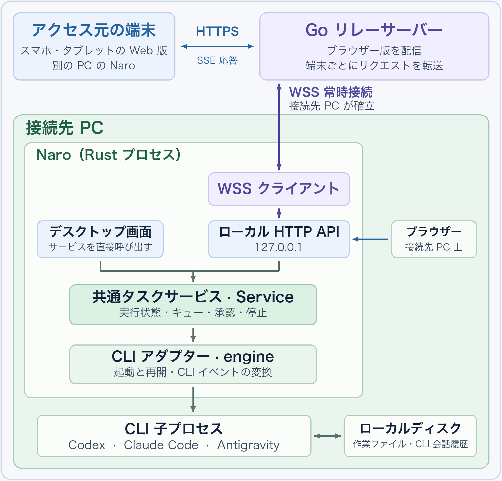
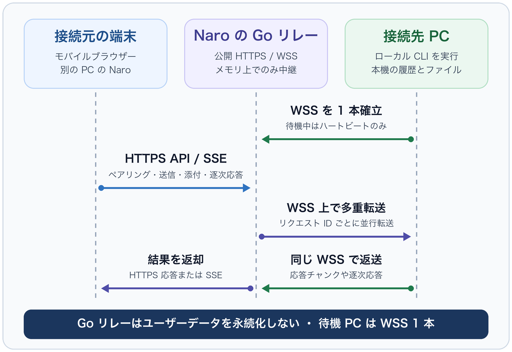

# Naro

[简体中文](README.md) · [English](README.en.md) · **日本語**

Codex、Claude Code、Antigravity のセッションを、PC・スマートフォン・タブレットから再開できます。Naro は接続先の PC で CLI を実行します。別の PC にある Naro デスクトップアプリや、スマートフォン・タブレットのブラウザーから接続できます。

[ソースコードの構成](#ソースコードの構成) · [システム構成](#システム構成) · [はじめに](#はじめに) · [Go リレーを配備する](#go-リレーを配備する) · [ソースからのビルドとテスト](#ソースからのビルドとテスト)

## ソースコードの構成

デスクトップアプリ、リレー、ブラウザー版、製品サイトはそれぞれ専用のディレクトリにあります。

```text
naro-link/
├── desktop/            # Rust デスクトップアプリとローカル API
│   ├── Cargo.toml      # Cargo のマニフェスト
│   ├── Cargo.lock      # Rust 依存関係の固定バージョン
│   ├── build.rs        # Windows リソースのビルドスクリプト
│   ├── src/            # 画面、タスクサービス、CLI アダプター
│   ├── assets/         # アイコン、フォント、更新用公開鍵
│   ├── vendor/         # 修正済みの Rust の依存ライブラリ
│   ├── scripts/        # パッケージ化・インストール・署名
│   └── tests/          # 実際の CLI を使う検証
├── relay/              # Go リレーサーバー
│   ├── go.mod          # Go モジュールの設定
│   ├── relay.go        # リレーの起動と端末別ルーティング
│   ├── relay_ws.go     # WebSocket 接続と転送
│   ├── relay_stream.go # ストリーミング経路とタイムアウト
│   ├── relay_test.go   # リレーの単体テスト
│   ├── Dockerfile      # リレーイメージのビルド
│   ├── compose.yml     # リレーコンテナーの設定
│   └── scripts/        # リレーの配備
├── web/                # 共有のブラウザー版
│   ├── public/         # HTML・CSS・JavaScript・アイコン
│   ├── embed.go        # リレーへのブラウザー版の組み込み
│   ├── go.mod          # ブラウザー資産を組み込む Go モジュール
│   └── tests/          # ブラウザー画面の回帰テスト
├── site/               # 製品紹介・ダウンロードサイト
├── tests/              # デスクトップ版とリレーの統合テスト・モック CLI
└── docs/               # 構成図と検証記録
```

デスクトップ版とリレーはそれぞれ `web/public/` を実行ファイルに組み込みます。Docker ではリレーコンテナーがブラウザー版も配信します。デスクトップ版の配布物は `desktop/dist/`、リレーの実行ファイルは `relay/dist/` に出力します。

### `desktop/src/` の中身

Rust では同じ名前のファイルとディレクトリでモジュールを構成できます。たとえば `web.rs` が `web` モジュール本体で、`web/` にサブモジュールが入ります。`web.rs` の `mod remote;` は `web/remote.rs`、その中の `mod ws;` は `web/remote/ws.rs` に対応します。以下は主なファイルです。

```text
desktop/src/
├── main.rs             # デスクトップアプリの起動入口
├── desktop.rs          # デスクトップアプリ本体と画面の状態
├── desktop/            # デスクトップ画面のサブモジュール
│   ├── ui.rs           # 画面のレイアウトと操作
│   ├── workspace.rs    # ローカル・リモート操作の振り分け
│   ├── remote.rs       # 別の PC にアクセスするクライアント
│   ├── file_tree.rs    # デスクトップ版のファイルツリー
│   └── git.rs          # デスクトップ版の Git パネル
├── web.rs              # ローカル HTTP サーバーと API ルート
├── web/                # HTTP サーバーのサブモジュール
│   ├── auth.rs         # ペアリングと認証
│   ├── stream.rs       # SSE によるタスク更新の配信
│   ├── remote.rs       # 接続先 PC からリレーへの接続
│   └── remote/         # remote モジュールのサブディレクトリ
│       └── ws.rs       # リレー接続の WebSocket 実装
├── service.rs          # デスクトップ版と Web 版が共有するセッション・タスク・キュー
├── service/            # 権限やタイトルなどを扱うタスクサービスのサブモジュール
├── engine.rs           # 共通の型定義と CLI ごとの振り分け
├── engine/             # 各 CLI のアダプターと共通ツール
│   ├── codex.rs        # Codex アダプター
│   ├── claude.rs       # Claude Code アダプター
│   ├── antigravity.rs  # Antigravity アダプター
│   └── process.rs      # CLI 実行ファイルの検出とプロセス起動
├── file_preview.rs     # プレビュー用のテキストファイルの読み込み
├── git.rs              # 画面と API が共用する Git 操作
├── settings.rs         # ローカルデータの場所、CLI パス、プロキシ設定
├── syntax.rs           # デスクトップ版と Web 版に共通の構文強調
├── update.rs           # デスクトップ版の更新確認・ダウンロード
└── update/             # デスクトップ版の更新インストール
```

### ソースコードの入口

- **デスクトップアプリ** · [main.rs](desktop/src/main.rs) · [desktop.rs](desktop/src/desktop.rs) · [web.rs](desktop/src/web.rs) · [service.rs](desktop/src/service.rs) · [engine/](desktop/src/engine/)
- **リレー** · [relay.go](relay/relay.go) · [compose.yml](relay/compose.yml)
- **ブラウザー版** · [index.html](web/public/index.html) · [app.js](web/public/app.js)
- **統合テスト** · [e2e.mjs](tests/e2e.mjs) · [mock-cli.mjs](tests/mock-cli.mjs)

## システム構成

**セッションは作業ディレクトリがある PC で実行します。** この接続先 PC で Naro とログイン済みの CLI が動作します。同じ PC ではデスクトップ画面やブラウザーから直接操作できます。スマートフォンや別の PC からは Go リレーを経由して同じ PC に接続します。



### 接続先 PC の内部構成

- **操作の入口。** デスクトップ画面、ローカル HTTP API、WSS クライアントは同じ Rust プロセス内にあります。デスクトップ画面はタスクサービスを直接呼び出します。ブラウザーやリレーからのリクエストは HTTP API を通ります。
- **タスク管理。** 共通の `Service` が実行状態、キュー、実行中のターンへの指示、停止、承認を扱います。同じ PC につないだ端末から同じタスクを確認・操作できます。
- **実行。** `engine` は対応する CLI の子プロセスを呼び出してセッションを開始・再開し、その出力をタスクイベントに変換します。作業ファイルと CLI の会話履歴は接続先 PC に保存されます。

### スマートフォンからメッセージを送る

スマートフォンのブラウザーは HTTPS でメッセージを Go リレーに送信します。リレーはデバイス ID から接続先 PC を特定し、その PC が確立した WSS 接続でリクエストを転送します。Naro はリクエストをローカル API に渡します。CLI の出力は同じ WSS 接続とリレーを通り、SSE でブラウザーに逐次届きます。

## はじめに

接続先の PC に使用する CLI（`codex`、`claude`、`agy`）をインストールし、ログインしておきます。macOS では ZIP を展開し、`Naro.app` を「アプリケーション」に移動してから開きます。Windows では書き込み可能なフォルダーから `Naro.exe` を起動します。ソースからのビルド手順は後述します。

サイドバーから既存のセッションを選べます。新規セッションでは、エンジンと接続先 PC の作業ディレクトリを選びます。Codex のセッションは登録済みのプロジェクトごとに表示され、過去のセッションも作業ディレクトリから所属先を特定できれば対応するプロジェクトに表示されます。プロジェクトの横にある **＋** からセッションを作成できます。フォルダーが複数ある場合は、その中から作業先を選びます。Claude Code と Antigravity では、以前に使った作業ディレクトリを選べます。

- モデルメニューには、CLI が提供するモデルと、各モデルで利用できる推論の強度が表示されます。高速モード対応モデルでは、メニュー横の稲妻ボタンで速度を切り替えられます。塗りつぶされた稲妻は高速モード、輪郭だけの稲妻は標準速度です。応答中にモデルを変更した場合、次のターンにはメッセージ送信時の設定が適用されます。
- デスクトップ版またはウェブ版の **設定 → 一般 → 表示言語** で、簡体字中国語、英語、日本語を選べます。変更はすぐに反映され、クライアントごとに記憶されます。ウェブ版ではペアリング前にも設定を開けます。
- **設定 → 一般 → 外観** で **ライト / ダーク / システムに合わせる** を選べます。初期値はシステムに合わせるで、現在のデバイスの外観に従います。変更はすぐに反映され、デスクトップとウェブで別々に記憶されます。同じブラウザーのタブ間ではウェブの設定が同期されます。
- **使用量 → トークン使用量** で、過去24時間、7日間、30日間の合計とエンジン別の内訳を確認できます。入力にはキャッシュの読み取りと書き込みが含まれます。接続先の CLI 履歴を使用し、アーカイブ済みの Codex セッションと Antigravity の SQLite セッションにも対応します。**アカウントの利用上限** では残りの利用枠とリセット時刻を確認できます。
- デスクトップとブラウザーのどちらからも応答中にメッセージを追加できます。**キューに追加**を選ぶと、現在のターンが終わってから順番に送信されます。**応答を誘導**では、新規のメッセージやキュー内のメッセージを、同じモデルで実行中のターンに送れます（Codex、Claude Code、Antigravity に対応）。送信方法は **設定 → セッション**で変更でき、クライアントごとに記憶されます。初期値はキューへの追加です。応答中に入力欄を空にすると **停止** が表示されます。停止すると、キューに残ったメッセージは未送信になります。
- 入力欄の上にあるキューで **取り消して編集** を選ぶと、メッセージと画像が入力欄に戻ります。書きかけの内容には **下書きを切り替え** で戻れます。再送すると編集後のメッセージはキューの末尾に入ります。自分のメッセージとアシスタントの応答はコピーアイコンでコピーできます。
- アシスタントの応答内のファイルリンクから、コピーと再読み込みができる読み取り専用プレビューを開けます。PC では右側、スマートフォンのブラウザーでは全画面で表示します。Web 版で表示できるのは、セッションの作業ディレクトリ内のファイルです。Markdown は初期状態で整形表示され、**プレビュー / ソース**を切り替えられます。他の UTF-8 テキストはソースを表示します。上限は 1 ファイル 2 MiB で、256 KiB を超える Markdown はソースのみ表示します。デスクトップ版では **フォルダーに表示**も利用でき、小さいウィンドウではプレビュー中にセッション一覧を一時的に隠します。
- 入力欄では **Enter** で送信、**Shift+Enter** で改行します。**⌘V**（macOS）、**Ctrl+V**、または右クリックメニューで、テキストやスクリーンショット、画像を貼り付けられます。
- PNG、JPEG、GIF、WebP を 1 回につき 4 枚まで、元画像の合計で 12 MiB まで添付できます。デスクトップとブラウザーの **画像**（**图片**）ボタンでファイルを選ぶこともできます。接続先 PC で画像を検証・変換し、CLI に渡します。最近の実行で使った画像はブラウザーでプレビューできます。

同じ PC でブラウザー版を使うには、**デバイス接続 → この PC の Web 版を開く**（**设备连接 → 打开本机网页**）を選びます。既定のアドレスは `http://127.0.0.1:4318` です。

## リレーの仕組み

**Naro の Go リレーはユーザーデータを永続化しません。** メッセージ、添付ファイル、ファイルのプレビュー、ペアリング記録はいずれもリレーのディスクに保存されず、メモリ上でのみ転送されます。会話履歴は接続先 PC 上の各 CLI が管理し、プロジェクトのファイルも接続先 PC の作業ディレクトリから読み込みます。



接続先 PC は受信用ポートを公開せず、Go リレーへ **1 本の WSS 接続**を能動的に確立し、待機中はハートビートのみを送受信します。リレーはその 1 本の接続上でリクエスト ID ごとに通常リクエスト・チャンク応答・逐次応答を並行転送するため、逐次応答中でも停止・承認・追加メッセージを即座に処理できます。ブラウザーや別の PC のデスクトップアプリは HTTPS API を使います。ブラウザーは SSE で逐次応答を受け取ります。ペアリングコードは接続先 PC が検証し、認証情報は接続元の端末が保持します。リレーはデバイスルーティング・デバイス名・オンライン状態のみをメモリに保持し、転送完了・タイムアウト・切断時に待機中のリクエストを速やかに解放します。切断やリレー再起動後はランダムジッター付きバックオフで自動再接続し、送信済みリクエストを自動で再実行しません。

公式サービスの HTTPS リバースプロキシ（Nginx）は、接続元 IP アドレスやリクエストパスを含むアクセスログを記録します。

## Go リレーを配備する

以下のコマンドはリポジトリのルートから実行します。Go 1.23 以降でリレーをビルドします。サーバー上で公開 HTTPS アドレスと接続トークンを設定します。以下の例では OpenSSL でランダムなトークンを生成します。例のドメインをお使いのドメインに置き換え、接続先にする各 PC に同じトークンを設定してください。リレーの再起動後も再接続できるよう、サービスの環境設定にトークンを保持します。

```sh
(cd relay && mkdir -p dist && go build -trimpath -ldflags="-s -w" -o dist/naro-relay .)
export NARO_PUBLIC_URL=https://naro.example.com
export NARO_RELAY_TOKEN="$(openssl rand -hex 32)"
./relay/dist/naro-relay
```

リレーの [Dockerfile](relay/Dockerfile) と [compose.yml](relay/compose.yml) を使い、Docker で配備することもできます（既定で `127.0.0.1:7319` にバインドする読み取り専用・非 root の `naro-relay` `scratch` イメージ）：

```sh
export NARO_PUBLIC_URL=https://naro.example.com
export NARO_RELAY_TOKEN="$(openssl rand -hex 32)"
docker compose -f relay/compose.yml up -d --build
```

既存の Compose 配備では `-p <既存のプロジェクト名>` を指定すると、同じコンテナーを引き続き管理できます。

| 環境変数 | 用途 |
| --- | --- |
| `NARO_PUBLIC_URL` | リレーの公開 HTTPS オリジン。スキームとホスト名、および必要に応じてポートを指定 |
| `NARO_RELAY_TOKEN` | リレーと接続先 PC で共有するランダムなトークン。空白を含まない 32〜512 文字の ASCII 文字列を使用 |
| `NARO_RELAY_ADDR` | リレーの待ち受けアドレス。既定値は `127.0.0.1:7319` |
| `NARO_TLS_CERT`、`NARO_TLS_KEY` | 任意。Go リレーで直接 HTTPS を提供する場合は、証明書ファイルと秘密鍵ファイルの両方を指定 |

HTTPS リバースプロキシを使う場合は、元の `Host` ヘッダーを保持し、HTTP/1.1 と WebSocket アップグレード（`Upgrade` / `Connection`）を有効にし、リクエストボディーの上限を 36 MiB 以上に設定して WSS と SSE のバッファリングを無効にします。Nginx + 単一 Go リレーの構成例は以下の通りです。

```nginx
map $http_upgrade $connection_upgrade {
    default upgrade;
    ''      close;
}

server {
    listen 443 ssl http2;
    server_name naro.example.com;

    ssl_certificate     /etc/letsencrypt/live/naro.example.com/fullchain.pem;
    ssl_certificate_key /etc/letsencrypt/live/naro.example.com/privkey.pem;

    client_max_body_size 36m;

    # 接続先 PC の WSS 長接続（待機時は 25 秒ごとにハートビート）
    location ~ "^/relay/devices/[a-f0-9]{32}/ws$" {
        proxy_pass http://127.0.0.1:7319;
        proxy_http_version 1.1;
        proxy_set_header Host $host;
        proxy_set_header Upgrade $http_upgrade;
        proxy_set_header Connection $connection_upgrade;
        proxy_buffering off;
        proxy_read_timeout 90s;
        proxy_send_timeout 90s;
    }

    # ブラウザー向け HTTPS API・SSE 逐次応答
    location / {
        proxy_pass http://127.0.0.1:7319;
        proxy_http_version 1.1;
        proxy_set_header Host $host;
        proxy_set_header Connection "";
        proxy_buffering off;
        proxy_read_timeout 90s;
        proxy_send_timeout 90s;
    }
}
```

Caddy を利用する場合は、以下のように設定できます。

```caddyfile
naro.example.com {
    reverse_proxy 127.0.0.1:7319
}
```

## 別の端末から接続する

1. 接続先 PC で **デバイス接続 → このコンピューターをペアリング**（**设备连接 → 本机配对**）を開き、リレーの HTTPS アドレスと接続トークンを入力して **接続**（**连接**）を選びます。リレーの設定は接続先の PC だけで行います。Windows の **保存して接続**（**保存并连接**）を選ぶと、トークンがシステムの資格情報に保存され、次回起動時に再接続できます。
2. 接続先 PC がオンラインになったら、スマートフォンの Naro ウェブ版で **QR コードで接続**（**扫码连接**）をタップし、PC の **このコンピューターをペアリング** タブにある QR コードを読み取ります。カメラアプリで読み取り、リンクを開くこともできます。接続先 PC と Naro は起動したままにします。
3. 接続先 PC で **デバイス接続 → このコンピューターをペアリング → 手動ペアリング**（**设备连接 → 本机配对 → 手动配对**）を開き、デバイスアドレスと 8 桁のペアリングコードを確認します。別の PC の Naro で **デバイス接続 → デバイスに接続**（**设备连接 → 连接其他设备**）を開き、アドレスとコードを入力して **ペアリングして接続**（**配对并连接**）を選びます。**このコンピューターに戻る**（**返回本机**）で自分のワークスペースに戻れます。Naro を開いている間は、最後にペアリングした PC に再接続できます。デバイスアドレスとコードはブラウザーからの接続にも使えます。
4. 1 台のリレーで複数の PC に接続できます。ペアリング済みの PC に戻るには、ブラウザー版のサイドバーにある **デバイスを切り替え**（**切换设备**）か、リレーのホームページにある **デバイス一覧**（**设备列表**）を使います。iPhone では、Safari の **共有 → ホーム画面に追加** にも対応しています。

接続先 PC の起動環境に `NAROLINK_RELAY_URL` と `NAROLINK_RELAY_TOKEN` を設定すると、Naro の起動時にリレーへ自動接続できます。デバイス名には既定でホスト名が使われます。`NAROLINK_DEVICE_NAME` で変更できます。

単一デバイス対応の旧バージョンから移行する場合は、リレーと接続先 PC の両方を更新し、新しいデバイスアドレスでペアリングし直します。旧バージョンのデスクトップアプリは、引き続きリレーのホームページでペアリングできます。

## CLI の設定

Codex は `app-server` 経由で既存のセッションを読み込みます。Claude Code はローカルの JSONL から履歴を読み込み、`--resume` で再開します。Antigravity は ACP 経由でセッションを読み込み、再開します。Antigravity のデスクトップアプリに由来するセッションには、対応するデータディレクトリを使います。

入力欄のモデルボタン横にある **権限**（**权限**）で、Codex と Claude Code の次のターンの実行権限を選べます。Codex の既定値は **承認を求める**（**请求批准**）です。作業ディレクトリ内の編集ができ、その外部での編集やネットワークアクセスにはユーザーの承認が必要です。**承認を任せる**（**替我批准**）では、対象となる承認リクエストを Codex が審査します。**フルアクセス**（**完全访问**）はローカルユーザーのファイル・ネットワーク権限を使います。**カスタム (config.toml)**（**自定义 (config.toml)**）はプロジェクトで有効な Codex の設定を使います。Claude Code では CLI が提供する権限モードを使います。Antigravity では、モデルボタン横の **CLI 実行モード**（**CLI 执行模式**）から、CLI が ACP 経由で提供するセッションモードを選べます。Antigravity デスクトップアプリのローカル権限プリセットは、アプリ本体で設定します。

デスクトップ版の **設定 → ネットワーク → CLI プロキシ**で HTTP または HTTPS プロキシを設定できます。保存後に Naro が起動する CLI に適用され、別の端末から開始した実行にも反映されます。アドレスを空にして保存すると、CLI は Naro の起動環境を継承します。

接続先 PC のデスクトップ版で **設定 → CLI パス** を開き、Codex、Claude Code、Antigravity の実行ファイルを個別に指定できます。絶対パスを入力するか、ファイルを選択してください。保存後に起動する CLI には指定したパスが優先されます。欄を空にして保存すると、起動時の環境変数（`NAROLINK_CODEX_CLI`、`NAROLINK_CLAUDE_CLI`、`NAROLINK_AGY_CLI`）や自動検出が使われます。

## デスクトップ版のアップデート

Naro は起動後にアップデートを確認します。**設定 → ソフトウェアアップデート**から手動でも確認できます。新しいバージョンをダウンロードし、タスクの完了後に再起動してインストールできます。`0.1.x` を使用している場合は、新しい起点となる `0.0.0` を一度手動でインストールしてください。[リリース手順](README.md#发布桌面更新)を参照してください。

## ソースからのビルドとテスト

デスクトップアプリには Rust 1.89 以降、リレーのビルドには Go 1.23 以降が必要です。エンドツーエンドテストには Node.js も必要です。以下のコマンドはリポジトリのルートから実行します。

**macOS**（Xcode Command Line Tools をインストールしてから実行）

```sh
sh desktop/scripts/package-macos.sh
(cd relay && mkdir -p dist && go build -o dist/naro-relay .)
node tests/e2e.mjs desktop/target/release/narolink relay/dist/naro-relay
```

スクリプトは `desktop/dist/Naro-<バージョン>-macOS-<アーキテクチャ>.zip` を生成します。ローカルで繰り返しインストールする場合は、`git config --local narolink.macosSigningIdentity '<コード署名用 ID>'` でキーチェーンの署名用 ID を設定すると、更新後もリムーバブルボリュームへのアクセス許可を引き継げます。環境変数 `NAROLINK_MACOS_SIGN_IDENTITY` で上書きできます。未設定の場合はアドホック署名を使用します。

**Windows**（MSVC ビルドツールをインストールし、Visual Studio Developer PowerShell で実行）

```powershell
cargo build --manifest-path desktop/Cargo.toml --release --locked
New-Item -ItemType Directory -Force desktop/dist
Copy-Item desktop/target/release/narolink.exe desktop/dist/Naro.exe
Push-Location relay
New-Item -ItemType Directory -Force dist
go build -o dist/naro-relay.exe .
Pop-Location
node tests/e2e.mjs desktop/dist/Naro.exe relay/dist/naro-relay.exe
```

Rust のテストは `cargo test --manifest-path desktop/Cargo.toml --locked`、Go のテストは `relay/` で `go test ./...` を実行します。エンドツーエンドテストではモック CLI を使用し、Go リレー 1 台と独立した Rust インスタンス 2 台で、ペアリング、リクエストの分離、元の ID でのセッション再開、画像の送受信、モデルの切り替え、実行の停止、承認操作を確認します。

## Web API

ペアリング後、以下の API を使用できます。リレー経由では各パスの先頭に `/devices/{device_id}` を付けます。ローカルの Web 版では表のパスをそのまま使います。書き込みリクエストには同一オリジンの `Origin` ヘッダーが必要です。`provider` には `codex`、`claude`、`antigravity` を指定できます。

| メソッドとパス | 用途 |
| --- | --- |
| `GET /api/sessions/{provider}` | 接続先 PC のセッション一覧を取得 |
| `GET /api/sessions/{provider}/{id}` | セッションのメタデータ、メッセージ履歴、実行中のタスクを取得 |
| `GET /api/models/{provider}` | モデル一覧と各モデルの推論の強度、高速モード対応状況を取得。`?settings=true` で権限とコラボレーションモードも取得 |
| `GET /api/usage` | 過去24時間、7日間、30日間の記録済みトークン使用量を合計およびエンジン別に取得 |
| `GET /api/activity` | 実行中および最近完了したタスクの一覧を取得 |
| `GET /api/runs` | 実行中のタスク一覧を取得 |
| `POST /api/runs` | タスクを開始し、ID を含む概要を返す。`provider`、`cwd`、`prompt` は必須。`session_id`、`project_id`、`images`、モデル設定は任意 |
| `GET /api/runs/{id}` | 応答のスナップショット、実行状況、承認待ちの操作、未回答の質問、追加メッセージの送信状況を取得 |
| `POST /api/runs/{id}/messages` | `mode`（`queue` または `steer`）、`prompt`、任意の `images` でメッセージを追加。キューへの追加時は `options` で次のターンのモデル設定を指定可能 |
| `POST /api/runs/{id}/messages/{message_id}/steer` | キュー内のメッセージを実行中のターンへ送る |
| `POST /api/runs/{id}/messages/{message_id}/withdraw` | 送信待ちのメッセージをキューから外し、`prompt` と Base64 エンコード済みの PNG `images` を返す。再アップロード時に `display_name` を指定すると元のファイル名を保持できる |
| `GET /api/runs/{id}/images/{index}` | 最近のタスクから PNG に変換された画像を取得 |
| `GET /api/previews/{key}` | メッセージが参照する画像のプレビューを取得 |
| `GET /api/file-previews/{key}` | リンク先の作業ディレクトリ内のテキストを取得し、対応する場合は Markdown の整形結果も返す |
| `POST /api/runs/{id}/stop` | タスクを停止 |
| `POST /api/runs/{id}/approval` | `approval_id` と真偽値の `allow` を送信 |
| `POST /api/runs/{id}/answer` | `question_id` と `answers` を送信。`answers` は個々の設問 ID をキー、選択肢や自由入力の文字列配列を値とするマップ |

`images` の各要素には `name` と Base64 エンコード済みの `data` を指定します。モデル設定には `model`、`reasoning_effort`、`fast_mode`、`permission_mode`、`approval_policy`、Codex の `collaboration_mode`（`default` または `plan`）があります。Codex の `permission_mode` では `request-approval`、`approve-for-me`、`full-access`、`custom` を指定できます。選択したプリセットで承認ポリシーが決まります。旧形式のリクエストでは、引き続きサンドボックスモードと `approval_policy` を指定できます。

## ライセンス

Naro のソースコードは [MIT ライセンス](LICENSE) で公開されています。同梱の Noto Sans CJK SC フォントは [SIL Open Font License 1.1](desktop/assets/OFL.txt) で提供されます。
