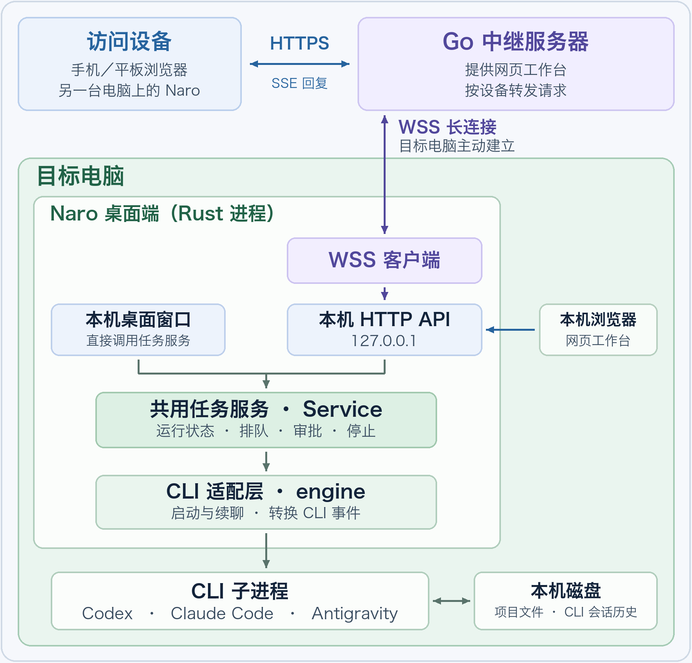
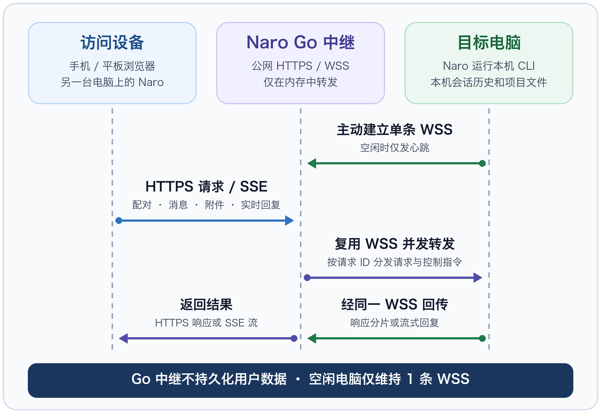

# Naro

**简体中文** · [English](README.en.md) · [日本語](README.ja.md)

在电脑、手机和平板之间接续 Codex、Claude Code 和 Antigravity 会话。目标电脑上的 Naro 桌面端运行 CLI，其他电脑可通过 Naro 桌面端连接，手机和平板可通过网页连接。

[源码目录](#源码目录) · [系统架构](#系统架构) · [开始使用](#开始使用) · [部署 Go 中继](#部署-go-中继) · [从源码构建与测试](#从源码构建与测试)

## 源码目录

桌面端、中继、网页工作台和产品站各有自己的目录。

```text
naro-link/
├── desktop/            # Rust 桌面程序和本机服务
│   ├── Cargo.toml      # Cargo 构建入口
│   ├── Cargo.lock      # Rust 依赖的锁定版本
│   ├── build.rs        # Windows 应用资源的构建脚本
│   ├── src/            # 桌面界面、任务服务和 CLI 适配
│   ├── assets/         # 桌面图标、字体和更新公钥
│   ├── vendor/         # 桌面端修补的 Rust 依赖
│   ├── scripts/        # 桌面打包、安装和签名
│   └── tests/          # 真实 CLI 验收
├── relay/              # Go 中继服务器
│   ├── go.mod          # Go 模块入口
│   ├── relay.go        # 中继入口和设备路由
│   ├── relay_ws.go     # WebSocket 连接与转发
│   ├── relay_stream.go # 流式路由和超时
│   ├── relay_test.go   # 中继单元测试
│   ├── Dockerfile      # 构建中继镜像
│   ├── compose.yml     # 启动中继容器
│   └── scripts/        # 中继部署
├── web/                # 共享的浏览器工作台
│   ├── public/         # HTML、CSS、JavaScript 和图标
│   ├── embed.go        # 中继的网页嵌入入口
│   ├── go.mod          # 网页资源的 Go 模块
│   └── tests/          # 网页界面回归测试
├── site/               # 产品介绍和下载站
├── tests/              # 桌面与中继联调、模拟 CLI
└── docs/               # 架构插图与验收记录
```

桌面端和中继都把 `web/public/` 打包进各自的程序。Docker 部署时，中继容器同时提供网页工作台。桌面安装包写入 `desktop/dist/`，中继二进制写入 `relay/dist/`。

### 展开 `desktop/src/`

Rust 用同名文件和目录组织一个模块。例如 `web.rs` 是 `web` 模块的主体，`web/` 放它的子模块。`web.rs` 中的 `mod remote;` 对应 `web/remote.rs`，该文件里的 `mod ws;` 再对应 `web/remote/ws.rs`。下面展开常用文件。

```text
desktop/src/
├── main.rs             # 桌面程序启动入口
├── desktop.rs          # 桌面应用主体和界面状态
├── desktop/            # 桌面界面的子模块
│   ├── ui.rs           # 桌面界面布局与交互
│   ├── workspace.rs    # 分发本机和远程操作
│   ├── remote.rs       # 桌面端访问另一台电脑
│   ├── file_tree.rs    # 桌面工作区文件树
│   └── git.rs          # 桌面的 Git 面板
├── web.rs              # 本机 HTTP 服务与 API 路由
├── web/                # HTTP 服务的子模块
│   ├── auth.rs         # 配对与访问鉴权
│   ├── stream.rs       # 通过 SSE 返回任务更新
│   ├── remote.rs       # 目标电脑接入中继
│   └── remote/         # remote 模块的子目录
│       └── ws.rs       # 中继连接的 WebSocket 实现
├── service.rs          # 桌面和网页共用的会话、任务与队列
├── service/            # 权限和标题等任务服务子模块
├── engine.rs           # 定义共用类型，按 CLI 分发任务
├── engine/             # 各 CLI 的适配代码和共用工具
│   ├── codex.rs        # Codex 适配
│   ├── claude.rs       # Claude Code 适配
│   ├── antigravity.rs  # Antigravity 适配
│   └── process.rs      # 查找并启动 CLI 进程
├── file_preview.rs     # 读取文本文件以供预览
├── git.rs              # 执行 Git 操作，供界面和 API 共用
├── settings.rs         # 本机数据目录、CLI 路径和代理设置
├── syntax.rs           # 桌面和网页共用的语法高亮
├── update.rs           # 桌面更新检查与下载
└── update/             # 桌面更新的安装逻辑
```

### 源码入口

- **桌面端** · [main.rs](desktop/src/main.rs) · [desktop.rs](desktop/src/desktop.rs) · [web.rs](desktop/src/web.rs) · [service.rs](desktop/src/service.rs) · [engine/](desktop/src/engine/)
- **中继** · [relay.go](relay/relay.go) · [compose.yml](relay/compose.yml)
- **网页工作台** · [index.html](web/public/index.html) · [app.js](web/public/app.js)
- **联调测试** · [e2e.mjs](tests/e2e.mjs) · [mock-cli.mjs](tests/mock-cli.mjs)

## 系统架构

**会话在项目所在的电脑上运行。** 这台目标电脑运行 Naro 和已登录的 CLI。本机可以用桌面窗口或浏览器操作，手机和另一台电脑通过 Go 中继接入同一台目标电脑。



### 目标电脑上的分层

- **接入。** 桌面窗口、本机 HTTP API 和 WSS 客户端都在同一个 Rust 进程里。桌面窗口直接调用任务服务。本机浏览器和中继转来的请求通过 HTTP API 进入。
- **任务。** 共用的 `Service` 管理运行状态、排队、引导、停止和审批。接入同一台目标电脑的设备可以查看和操作同一个任务。
- **执行。** `engine` 调用对应的 CLI 子进程来开启或续聊会话，并把 CLI 输出转成任务事件。项目文件和 CLI 会话历史都保存在目标电脑上。

### 从手机发一条消息

手机网页用 HTTPS 把消息发给 Go 中继。中继按设备 ID 找到目标电脑，沿这台电脑主动建立的 WSS 长连接转发请求。Naro 把请求交给本机 API。网页通过 SSE 事件流接收 CLI 的实时输出，输出也沿这条 WSS 连接经中继返回。

## 开始使用

在目标电脑安装并登录要使用的 CLI（`codex`、`claude` 或 `agy`）。macOS 解压后将 `Naro.app` 拖入「应用程序」再打开。Windows 将 `Naro.exe` 放在可写目录中运行。也可以按下文从源码构建。

从侧栏选择已有会话，或选择引擎和目标电脑上的工作目录开始新会话。Codex 会话按登记的项目显示，能从工作目录确定归属的旧会话也会归入对应项目。点击项目旁的 **＋** 可在该项目中新建会话。项目包含多个文件夹时，可以选用其中一个。Claude Code 和 Antigravity 可以选择用过的工作目录。

- 在桌面端或网页端的 **设置 → 通用 → 界面语言** 中，可切换简体中文、English 和日本語。切换立即生效，各端分别记住选择。网页配对前也可以打开设置。
- 在 **设置 → 通用 → 外观** 中选择 **浅色 / 深色 / 跟随系统**，默认跟随当前设备的系统外观。切换立即生效，桌面和网页各自记住选择；网页同一浏览器的标签页会同步外观设置。
- 模型菜单会显示 CLI 提供的模型及其支持的思考强度。支持快速模式的模型可以用旁边的闪电按钮切换速度，实心表示快速模式，空心表示标准速度。运行中切换模型后，下一轮使用发送时选定的设置。
- 点击侧栏底部的 **用量 → Token 用量**，查看目标电脑上 Codex、Claude Code 和 Antigravity 最近 24 小时、7 天或 30 天有记录的总消耗及分引擎用量。输入包含缓存读取和写入。统计使用目标电脑保留的 CLI 历史，支持已归档的 Codex 会话和 Antigravity 的 SQLite 会话。
- 在 **用量 → 账号额度** 查看各引擎登录账号的剩余额度和重置时间。有可用重置次数的 Codex 账号可在这里确认使用 1 次。Claude Code 需要当前登录方式提供套餐额度。Antigravity CLI 需要 1.1.11 或更新版本。
- 桌面和网页都支持在回复期间发送后续消息。**加入队列** 会在当前轮结束后按顺序发送。**引导会话** 可将新消息或已排队的消息送入当前轮，并沿用该轮的模型（支持 Codex、Claude Code 和 Antigravity）。可在 **设置 → 会话** 中更改发送方式，各端会记住选择，默认加入队列。运行中清空草稿后可点击 **停止**，队列里剩下的消息会标为未发送。
- 输入框上方的队列支持 **撤回修改**。消息和图片回到输入框，可用 **切换草稿** 找回原来在写的内容。修改后重新发送会排到队尾。自己的消息和助手回复都可通过复制图标复制文字。
- 点击助手回复中的文件链接可打开只读预览，支持复制和刷新。桌面端和电脑浏览器在右侧打开，手机浏览器全屏打开。网页支持当前会话工作目录内的文件。Markdown 默认渲染，可切换 **预览 / 原始内容**。其他 UTF-8 文本显示源码。单文件上限 2 MiB，超过 256 KiB 的 Markdown 仅显示原始内容。桌面端还可 **在文件夹中显示**，小窗口预览时会暂时收起会话列表。
- 桌面端与网页端顶部栏均提供 **Git 管理** 入口，跟随当前会话或选定的工作目录，支持查看仓库状态与文件 Diff、暂存 / 取消暂存、丢弃更改、提交（含 Amend）、新建与切换本地分支、查看近期提交历史与提交 Diff，以及 Fetch / Pull / Push 远端同步（远程连接其他电脑时同样可用）。
- 输入框按 **Enter** 发送、按 **Shift+Enter** 换行。用 **⌘V**（macOS）、**Ctrl+V** 或右键菜单粘贴文字、截图和图片。
- 支持 PNG、JPEG、GIF 和 WebP 图片，每次最多 4 张，原图合计最多 12 MiB。在桌面或网页也可以点击 **图片** 选择文件。目标电脑会验证并规范化图片，再交给 CLI。网页可以预览近期任务的图片。

同一台电脑可通过 **设备连接 → 打开本机网页** 使用浏览器工作台，默认地址是 `http://127.0.0.1:4318`。

Naro 桌面端会在启动后检查更新，也可以打开 **设置 → 软件更新** 手动检查。发现新版本后，可下载并在任务结束后确认重启安装。之前使用 `0.1.x` 的用户需要先手动安装新的 `0.0.0` 起始版一次。

## 中继如何工作

**Naro Go 中继不持久化用户数据。** 聊天内容、附件、文件预览和配对记录都不在中继落盘，只在内存中转发。会话历史由目标电脑上的 CLI 管理，项目文件从目标电脑的工作区读取。



目标电脑只需主动建立 **1 条到 Go 中继的 WSS 长连接**，无需开放入站端口，空闲时只收发心跳。中继通过请求 ID 在这条连接上并发转发请求、分片响应和流式回复，流式输出期间仍可即时处理停止、审批和后续消息。浏览器和远程桌面端使用 HTTPS API，网页通过 SSE 接收流式回复。配对码由目标电脑验证，配对凭证保存在访问端；中继仅在内存中维护设备路由、设备名和在线状态，转发结束、超时或断线后及时清理。断线或中继重启后，目标电脑使用带随机抖动的退避策略自动重连，且不会自动重复执行已发出的写操作。

官方部署的 HTTPS 反向代理（Nginx）会记录访问日志，包括来源 IP 和请求路径。

## 部署 Go 中继

从仓库根目录执行以下命令。使用 Go 1.23 或更新版本构建中继。在服务器上为中继进程设置公开 HTTPS 地址和连接密钥。下面的示例用 OpenSSL 生成随机密钥。把域名替换为自己的域名，将同一个密钥填入需要连接的目标电脑。长期运行时，在服务的环境配置中保留该密钥，以便中继重启后仍可连接。

```sh
(cd relay && mkdir -p dist && go build -trimpath -ldflags="-s -w" -o dist/naro-relay .)
export NARO_PUBLIC_URL=https://naro.example.com
export NARO_RELAY_TOKEN="$(openssl rand -hex 32)"
./relay/dist/naro-relay
```

也可以使用中继目录的 [`Dockerfile`](relay/Dockerfile) 和 [`compose.yml`](relay/compose.yml) 通过 Docker 部署（基于 `scratch` 的只读非 root `naro-relay` 镜像，默认绑定 `127.0.0.1:7319`）：

```sh
export NARO_PUBLIC_URL=https://naro.example.com
export NARO_RELAY_TOKEN="$(openssl rand -hex 32)"
docker compose -f relay/compose.yml up -d --build
```

已有 Compose 部署可加 `-p <原项目名>`，让新配置继续管理原来的容器。

| 环境变量 | 用途 |
| --- | --- |
| `NARO_PUBLIC_URL` | 中继的公开 HTTPS 地址，仅包含协议、主机名和可选端口 |
| `NARO_RELAY_TOKEN` | 中继与目标电脑共享的随机密钥，使用 32 至 512 个无空格的 ASCII 字符 |
| `NARO_RELAY_ADDR` | 中继监听地址，默认 `127.0.0.1:7319` |
| `NARO_TLS_CERT`、`NARO_TLS_KEY` | 可选。由 Go 中继直接提供 HTTPS 时，同时指定证书和私钥文件 |

使用 HTTPS 反向代理时，保留原始 `Host`，启用 HTTP/1.1 与 WebSocket 升级（`Upgrade` / `Connection`），允许至少 36 MiB 的请求体，并对 WSS 与 SSE 关闭响应缓冲。以 Nginx + 单 Go 中继为例：

```nginx
map $http_upgrade $connection_upgrade {
    default upgrade;
    ''      close;
}

server {
    listen 443 ssl http2;
    server_name naro.example.com;

    ssl_certificate     /etc/letsencrypt/live/naro.example.com/fullchain.pem;
    ssl_certificate_key /etc/letsencrypt/live/naro.example.com/privkey.pem;

    client_max_body_size 36m;

    # 目标电脑 WSS 长连接（空闲时每 25 秒心跳一次）
    location ~ "^/relay/devices/[a-f0-9]{32}/ws$" {
        proxy_pass http://127.0.0.1:7319;
        proxy_http_version 1.1;
        proxy_set_header Host $host;
        proxy_set_header Upgrade $http_upgrade;
        proxy_set_header Connection $connection_upgrade;
        proxy_buffering off;
        proxy_read_timeout 90s;
        proxy_send_timeout 90s;
    }

    # 网页 HTTPS API 与 SSE 流式回复
    location / {
        proxy_pass http://127.0.0.1:7319;
        proxy_http_version 1.1;
        proxy_set_header Host $host;
        proxy_set_header Connection "";
        proxy_buffering off;
        proxy_read_timeout 90s;
        proxy_send_timeout 90s;
    }
}
```

如果使用 Caddy，也可以直接反向代理：

```caddyfile
naro.example.com {
    reverse_proxy 127.0.0.1:7319
}
```

## 连接其他设备

1. 在目标电脑打开 **设备连接 → 本机配对**，填写中继的 HTTPS 地址和连接密钥，然后点击 **连接**。只需在目标电脑配置中继。Windows 上的按钮是 **保存并连接**，会将密钥存入系统凭据，供下次启动时重连。
2. 等目标电脑上线后，在手机的 Naro 网页点 **扫码连接**，对准目标电脑 **本机配对** 页签里的二维码。也可以用手机系统相机扫码后打开链接。保持目标电脑和 Naro 运行。
3. 在目标电脑打开 **设备连接 → 本机配对 → 手动配对**，复制设备地址并查看 8 位配对码。在另一台电脑打开 Naro 的 **设备连接 → 连接其他设备**，输入地址和配对码，点 **配对并连接**。用 **返回本机** 切回自己的工作台，Naro 保持打开时可重新连接最近配对的电脑。也可以在浏览器打开设备地址并输入配对码。
4. 同一中继可接入多台电脑。配对后可从网页侧栏的 **切换设备** 或中继首页的 **设备列表** 返回已配对的电脑。iPhone 可在 Safari 中选择 **分享 → 添加到主屏幕**。

目标电脑可以通过 `NAROLINK_RELAY_URL` 和 `NAROLINK_RELAY_TOKEN` 启动时自动连接中继。设备名默认取主机名，也可以设置 `NAROLINK_DEVICE_NAME`。

从旧的单设备版本升级时，请同时更新中继和目标电脑，再用新的设备地址重新配对。旧版桌面端仍可通过中继首页配对。

## CLI 设置

Codex 使用 `app-server` 读取原会话。Claude Code 从本机 JSONL 读取历史，并用 `--resume` 续聊。Antigravity 通过 ACP 读取和续聊，来自 Antigravity 桌面端的会话会使用对应的数据目录。

点击输入框中模型旁的 **权限** 按钮，选择 Codex 或 Claude Code 下一轮的运行权限。Codex 默认使用 **请求批准**，允许编辑工作区，编辑外部文件或联网时由你批准。**替我批准** 由 Codex 审查符合条件的请求。**完全访问** 使用本机账户的文件和网络权限。**自定义 (config.toml)** 使用当前项目生效的 Codex 配置。Claude Code 使用其 CLI 提供的权限模式。在 Antigravity 中，点击模型旁的 **CLI 执行模式** 可以选择由 CLI 通过 ACP 提供的会话模式。Antigravity 桌面版的本机权限预设在原生应用中设置。

在桌面端 **设置 → 网络 → CLI 网络代理** 中，可以为 Naro 新启动的 CLI 设置 HTTP 或 HTTPS 代理，也适用于从其他设备发起的任务。清空地址并保存后，CLI 会继承 Naro 的启动环境。

在目标电脑的 Naro 桌面端打开 **设置 → CLI 路径**，可分别为 Codex、Claude Code 和 Antigravity 粘贴可执行文件的绝对路径或用「选择文件」定位。保存后，新启动的 CLI 会优先使用设置的路径。清空某一项并保存后，Naro 会依次读取该引擎的启动环境变量（`NAROLINK_CODEX_CLI`、`NAROLINK_CLAUDE_CLI` 或 `NAROLINK_AGY_CLI`）和自动查找位置。

## 从源码构建与测试

桌面端需要 Rust 1.89 或更新版本。构建中继需要 Go 1.23 或更新版本。端到端测试还需要 Node.js。以下命令从仓库根目录执行。

**macOS**（安装 Xcode Command Line Tools 后执行）

```sh
sh desktop/scripts/package-macos.sh
(cd relay && mkdir -p dist && go build -o dist/naro-relay .)
node tests/e2e.mjs desktop/target/release/narolink relay/dist/naro-relay
```

脚本生成 `desktop/dist/Naro-<版本>-macOS-<架构>.zip`。本机反复安装时，可用 `git config --local narolink.macosSigningIdentity '<签名身份>'` 为此工作区固定一个钥匙串中的签名身份，让 macOS 在后续更新时沿用可移除卷授权。也可用环境变量 `NAROLINK_MACOS_SIGN_IDENTITY` 覆盖。未设置时使用 ad hoc 签名。

**Windows**（安装 MSVC 构建工具后，在 Visual Studio Developer PowerShell 中执行）

```powershell
cargo build --manifest-path desktop/Cargo.toml --release --locked
New-Item -ItemType Directory -Force desktop/dist
Copy-Item desktop/target/release/narolink.exe desktop/dist/Naro.exe
Push-Location relay
New-Item -ItemType Directory -Force dist
go build -o dist/naro-relay.exe .
Pop-Location
node tests/e2e.mjs desktop/dist/Naro.exe relay/dist/naro-relay.exe
```

Rust 测试用 `cargo test --manifest-path desktop/Cargo.toml --locked`，Go 测试在 `relay/` 下运行 `go test ./...`。端到端测试用模拟 CLI 启动一个 Go 中继和两个独立的 Rust 实例，覆盖设备配对、请求隔离、原 ID 续聊、图片传输、模型切换、停止和操作确认。

### 发布桌面更新

1. 用同一产品版本构建各平台的最终安装包。公开发行的 macOS 包可使用 `NAROLINK_MACOS_SIGN_IDENTITY` 指定 Developer ID Application，并用 `NAROLINK_MACOS_NOTARY_PROFILE` 指定 `notarytool` 的钥匙串配置，打包脚本会完成公证并附上票据。
2. 用发布者保存在本机的 Ed25519 私钥为最终安装包生成更新清单。公钥在 `desktop/assets/update-key.txt`，私钥保存在仓库和中继之外。

   ```sh
   node desktop/scripts/sign-update.mjs 0.0.0 "$NAROLINK_UPDATE_KEY_FILE" desktop/dist/Naro-0.0.0-macOS-arm64.zip desktop/dist/Naro.exe
   ```

3. 将 `desktop/dist/naro-update-v1.json` 和参与签名的安装包上传到对应的 GitHub Release 草稿（例如 `v0.0.0`），保留文件名，再作为最新的正式版本发布。客户端通过 HTTPS 检查签名清单，并按平台下载和校验安装包。

## 网页 API

配对后，浏览器可调用以下接口。通过中继连接时，在路径前加 `/devices/{device_id}`。本机网页直接使用表中的路径。写请求需要同源 `Origin`。可用的 `provider` 为 `codex`、`claude` 和 `antigravity`。

历史消息和运行快照的 `local_files` 仅提供文件或文件夹的显示名 `name` 和类型标记 `directory`，不返回本机路径或文件内容。

| 方法和路径 | 用途 |
| --- | --- |
| `GET /api/sessions/{provider}` | 列出本机会话 |
| `GET /api/sessions/{provider}/{id}` | 读取会话元数据、历史消息和正在运行的任务 |
| `GET /api/models/{provider}` | 列出模型及其支持的思考强度和快速模式。加 `?settings=true` 可同时读取权限和协作模式 |
| `GET /api/usage` | 统计目标电脑记录的 Token 用量，返回最近 24 小时、7 天和 30 天的总量及分引擎结果 |
| `GET /api/git/status` | 查询指定 `cwd` 工作目录的 Git 仓库状态、分支列表、远端与最近提交 |
| `GET /api/git/diff` | 查询指定 `cwd` 下已暂存、未暂存、未跟踪文件或指定提交的文本 Diff |
| `POST /api/git/action` | 对指定 `cwd` 执行 Git 操作（`stage`、`unstage`、`discard`、`commit`、`checkout`、`create_branch`、`fetch`、`pull`、`push`）并返回最新状态 |
| `GET /api/quotas/{provider}` | 读取目标电脑上 CLI 登录账号的剩余额度和重置信息 |
| `POST /api/quotas/codex/reset` | 使用一次 Codex 额度重置机会。请求提供 `idempotency_key`（UUID），同一次重试须沿用原值 |
| `GET /api/activity` | 列出运行中和近期完成的任务 |
| `GET /api/runs` | 列出正在运行的任务 |
| `POST /api/runs` | 开始任务，返回包含任务 ID 的摘要。请求提供 `provider`、`cwd` 和 `prompt`，可选 `session_id`、`project_id`、`images` 和模型设置 |
| `GET /api/runs/{id}` | 读取回复快照、运行状态、待审批操作、待回答问题和后续消息的发送状态 |
| `POST /api/runs/{id}/messages` | 发送后续消息。请求提供 `mode`（`queue` 或 `steer`）、`prompt` 和可选的 `images`。队列消息可通过 `options` 指定下一轮的模型设置 |
| `POST /api/runs/{id}/messages/{message_id}/steer` | 将排队消息送入当前轮 |
| `POST /api/runs/{id}/messages/{message_id}/withdraw` | 从队列撤回待发送的消息，返回 `prompt` 和 Base64 编码的 PNG `images`。重新上传时可用 `display_name` 保留原文件名 |
| `GET /api/runs/{id}/images/{index}` | 获取近期任务的规范化 PNG |
| `GET /api/previews/{key}` | 获取消息中提供的图片预览 |
| `GET /api/file-previews/{key}` | 读取回复链接指向的工作目录内文本文件，返回原文和可用的 Markdown 预览 |
| `POST /api/runs/{id}/stop` | 停止任务 |
| `POST /api/runs/{id}/approval` | 提交 `approval_id` 和布尔值 `allow` |
| `POST /api/runs/{id}/answer` | 提交 `question_id` 和 `answers`。后者以题目 ID 为键，值为选项或自定义文本组成的字符串数组 |

`images` 的每项包含 `name` 和 Base64 编码的 `data`。模型设置包括 `model`、`reasoning_effort`、`fast_mode`、`permission_mode`、`approval_policy` 和 Codex 的 `collaboration_mode`（`default` 或 `plan`）。Codex 的 `permission_mode` 支持 `request-approval`、`approve-for-me`、`full-access` 和 `custom`。所选预设决定审批策略。旧版请求仍可传入沙盒模式和 `approval_policy`。

## 许可证

Naro 源码采用 [MIT 许可证](LICENSE)。随附的 Noto Sans CJK SC 字体采用 [SIL Open Font License 1.1](desktop/assets/OFL.txt)。
